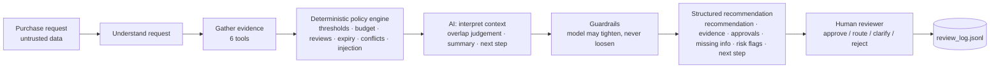
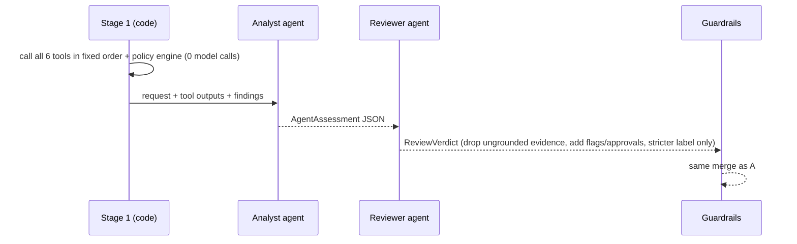

# Architecture & workflow

## Product workflow



## AI / CODE / HUMAN split

| Layer | Responsibility | Where |
|---|---|---|
| **CODE** (deterministic) | data lookups, budget arithmetic, approval thresholds (s4), 365-day assessment expiry (s5), registry-vs-service conflict (s5), privacy/legal triggers (s6-7), required-field check (s1), prompt-injection heuristics (s9), service-outage handling (s10), evidence grounding filter, "tighten-only" merge | `src/tools.py`, `src/policy_engine.py`, `src/injection.py`, `src/guardrails.py` |
| **AI** (probabilistic) | interpret the business justification, judge whether an existing tool really covers the need (s3), write the reviewer-facing summary and concrete next step, add stricter flags it notices | `src/architectures/*`, `src/prompts.py` |
| **HUMAN** | every approval, budget exception, security/privacy/legal sign-off, final decision; recorded in the UI | `app.py`, `src/review_log.py` |

`human_review_required` is always `true`: the copilot never approves, purchases, changes budgets or accepts terms (s11).

## Tools (7; 6 deterministic, 1 external)

| Tool | Kind | Source |
|---|---|---|
| `get_requester_profile` | deterministic | employees.csv |
| `check_department_budget` | deterministic | department_budgets.csv |
| `search_software_catalog` | deterministic | software_catalog.csv (same product / product family / vendor / category) |
| `get_vendor_registry_record` | deterministic | vendors.csv (+ days since review vs. policy reference date) |
| `get_vendor_risk_assessment` | **external API** (mock) | `GET /vendor-risk/{vendor}` with timeout + retry; 503/timeout -> `available=false` |
| `get_purchase_history` | deterministic | purchase_history.csv |
| `run_policy_checks` | deterministic rules engine | all of the above + procurement_policy.md |

All date logic uses the **policy reference date (2026-09-30)** parsed from `procurement_policy.md`, never the system clock.

## Architecture A - single agent

```mermaid
sequenceDiagram
    participant M as Model (single agent)
    participant T as Tools
    participant E as Policy engine
    participant G as Guardrails
    M->>T: chooses + calls evidence tools (parallel allowed)
    T-->>M: JSON results
    M->>E: run_policy_checks (tool)
    E-->>M: hard findings + floor recommendation
    M-->>G: AgentAssessment JSON (label, summary, evidence, overlap judgement, next step)
    G-->>G: union with floor; drop ungrounded evidence; label may only tighten
```

One model owns the loop: tool selection, policy tool, final JSON. Guardrails force `run_policy_checks` if the agent skipped it and auto-fetch any evidence it did not gather (recorded as `policy_autofetched` so the eval can see how often the agent cut corners). Typical cost: 2-4 model calls.

## Architecture B - staged / 2-agent



Exactly 2 model calls per request, no tool calling by the model. The Reviewer can only tighten the Analyst's package (`apply_review`); it gets a policy digest instead of the full policy text, and may override the overlap judgement only when the justification clearly describes a need an existing product already serves (not an add-on / seat / training expansion).

## Handoff format

Both architectures return `ProcurementDecision` (`src/contracts.py`): `recommendation` (one of *Approve / Route for review / Use existing tool / Request clarification / Manual review - evidence unavailable*), `evidence[]` (source = tool name, finding, reference), `required_approvals[]` (canonical roles), `missing_information[]`, `risk_flags[]` (taxonomy in `contracts.py`), `next_step`, `human_review_required=true`, `summary`, `telemetry` (LLM/tool calls, tokens, latency per stage, guardrail overrides).

## Stop / escalation conditions

| Condition | Result |
|---|---|
| Required field missing (s1) | `Request clarification`, `missing_information` listed, nothing routed |
| Vendor-risk service down / no record (s10) | `Manual review - evidence unavailable`, `vendor_risk_unavailable`, Security added |
| Security / privacy / legal / budget trigger | `Route for review` with the reviewers added to approvals |
| Registry and service disagree (s5) | `conflicting_vendor_evidence` + Security; never silently pick one |
| Instruction-like text in business data (s9) | `prompt_injection_detected`; text treated as data; approval claims ignored |
| Provider rate limit (429) | wait the provider's `retry-after` (up to `LLM_MAX_RATE_RETRIES` times), waits reported in telemetry |
| Model unavailable / invalid output (after one repair round) | deterministic assessment, `llm_unavailable` flag, human review |

## Assumptions

1. The request's `requester_id` determines the department whose budget is checked.
2. "Current" security assessment = status approved **and** reviewed within 365 days of 2026-09-30; a registry status of *Approved* with a review older than 365 days is treated as expired.
3. An external vendor-risk record of *not_completed* / *no record* / unavailable is never treated as favourable.
4. Data-access levels containing `pii`/`personal` need Privacy review; `source_code`, `production*`, `cloud`, `confidential*`, `*_pii`, `credential*` need Security review; integrations naming production/cloud/git systems need Security review. `SSO` alone does not.
5. Legal review: new vendor (registry status != Approved) with spend >= $10,000, non-approved legal terms, or cross-region processing of personal data.
6. Overlap (s3) is a judgement: catalog matches are deterministic evidence; whether an existing product covers the need is decided by the model (hard-flagged by code only for exact duplicates or a different vendor in the same category). In offline mode a keyword heuristic (add-on / expansion / training / renewal) is used instead.
7. `missing_information` is always produced by code (s1), never by the model, so complete requests cannot be sent back on a whim.
8. Prompt-injection detection is regex-based and conservative; the model may additionally raise `prompt_injection_detected` but can never clear it.

## What was intentionally not built

- No autonomous actions (purchase, approval, budget edits, vendor onboarding).
- No vector search / RAG over the policy: it is 4.6 KB and is passed verbatim to the model.
- No agent framework; a 60-line tool loop is easier to audit than an orchestration library.
- No LLM-as-judge in the eval: every quality criterion is checked by code against the expectation files.
